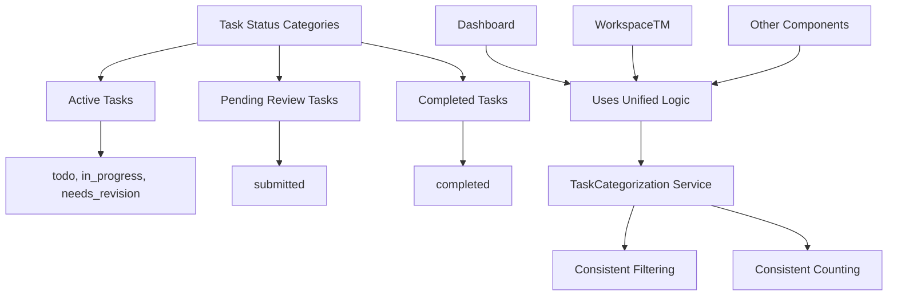
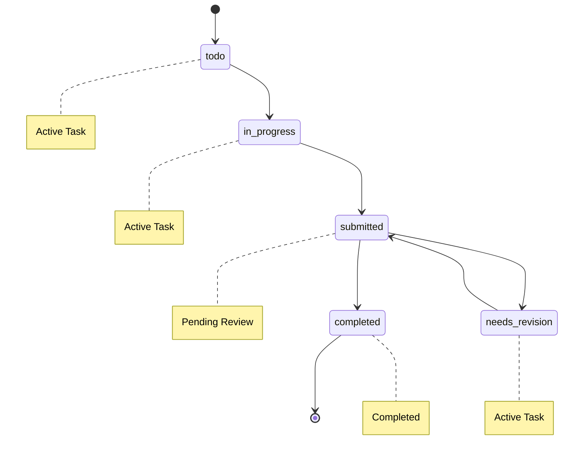

# Design Document

## Overview

This design addresses the task visibility inconsistency between the dashboard and workspace views by standardizing task filtering logic and ensuring consistent task counting across all components. The solution focuses on creating a unified task categorization system and updating the affected components to use consistent filtering criteria.

## Architecture

### Current Problem Analysis

**Dashboard Logic (StatisticsService.js)**:
- Counts ALL tasks assigned to user
- Calculates "remaining" as `total - completed`
- Includes `submitted` tasks in "remaining" count

**WorkspaceTM Logic**:
- Filters "current tasks" as `!["completed", "submitted"].includes(task.status)`
- Shows `submitted` tasks in separate "Submitted Tasks" section
- Excludes `submitted` from "My Tasks" count

**Result**: Dashboard shows 2 remaining, workspace shows 1 in "My Tasks"

### Solution Architecture



## Components and Interfaces

### 1. TaskCategorization Service

**Purpose**: Centralized logic for task filtering and counting

**Interface**:
```javascript
class TaskCategorizationService {
  // Get tasks that need user action (active work)
  getActiveTasks(tasks) {
    return tasks.filter(task => 
      ['todo', 'in_progress', 'needs_revision'].includes(task.status)
    );
  }
  
  // Get tasks pending review (submitted but not completed)
  getPendingReviewTasks(tasks) {
    return tasks.filter(task => task.status === 'submitted');
  }
  
  // Get completed tasks
  getCompletedTasks(tasks) {
    return tasks.filter(task => task.status === 'completed');
  }
  
  // Get tasks that count as "remaining work" for user
  getRemainingTasks(tasks) {
    return tasks.filter(task => 
      !['completed'].includes(task.status)
    );
  }
  
  // Get task counts by category
  getTaskCounts(tasks) {
    return {
      active: this.getActiveTasks(tasks).length,
      pendingReview: this.getPendingReviewTasks(tasks).length,
      completed: this.getCompletedTasks(tasks).length,
      remaining: this.getRemainingTasks(tasks).length
    };
  }
}
```

### 2. Updated StatisticsService

**Changes**:
- Use TaskCategorization service for consistent filtering
- Update "remaining" calculation to include submitted tasks
- Ensure dashboard counts match workspace display logic

**Key Method Updates**:
```javascript
calculateTaskStats(tasks) {
  const categorization = new TaskCategorizationService();
  const counts = categorization.getTaskCounts(tasks);
  
  return {
    total: tasks.length,
    completed: counts.completed,
    remaining: counts.remaining, // Includes submitted tasks
    active: counts.active,
    pendingReview: counts.pendingReview,
    completionRate: tasks.length > 0 ? Math.round((counts.completed / tasks.length) * 100) : 0,
    byStatus: {
      todo: tasks.filter(t => t.status === 'todo').length,
      inProgress: tasks.filter(t => t.status === 'in_progress').length,
      submitted: tasks.filter(t => t.status === 'submitted').length,
      completed: tasks.filter(t => t.status === 'completed').length,
      needsRevision: tasks.filter(t => t.status === 'needs_revision').length
    }
  };
}
```

### 3. Updated RemainingTasksCard

**Changes**:
- Update terminology to be clearer about what "remaining" means
- Show breakdown that matches workspace view
- Include submitted tasks in remaining count explanation

**Key Updates**:
```javascript
// Update display logic
const activeTasks = categorization.getActiveTasks(allTasks);
const pendingReviewTasks = categorization.getPendingReviewTasks(allTasks);
const remainingTasks = activeTasks.length + pendingReviewTasks.length;

// Update messaging
<Typography variant="body2" color="text.secondary">
  Tasks requiring your attention (includes submitted tasks awaiting review)
</Typography>
```

### 4. Updated WorkspaceTM

**Changes**:
- Use TaskCategorization service for consistent filtering
- Update section titles to match dashboard terminology
- Ensure task counts align with dashboard

**Key Updates**:
```javascript
// Replace current filtering logic
const categorization = new TaskCategorizationService();
const activeTasks = categorization.getActiveTasks(tasks);
const pendingReviewTasks = categorization.getPendingReviewTasks(tasks);
const completedTasks = categorization.getCompletedTasks(tasks);

// Update section title
<Typography variant="h6">
  Active Tasks ({activeTasks.length})
</Typography>
```

## Data Models

### Task Status Flow



### Task Categories

| Category | Statuses | Dashboard Count | Workspace Display |
|----------|----------|----------------|-------------------|
| Active | todo, in_progress, needs_revision | Part of "remaining" | "Active Tasks" section |
| Pending Review | submitted | Part of "remaining" | "Submitted Tasks" section |
| Completed | completed | Not in "remaining" | "Completed Tasks" section |

## Error Handling

### Consistency Validation

**Runtime Checks**:
- Validate that dashboard counts match workspace display
- Log warnings when inconsistencies are detected
- Provide fallback logic if categorization fails

**Error Recovery**:
```javascript
// Fallback to original logic if categorization service fails
try {
  const counts = categorization.getTaskCounts(tasks);
  return counts;
} catch (error) {
  console.warn('TaskCategorization failed, using fallback logic:', error);
  return this.getFallbackTaskCounts(tasks);
}
```

## Testing Strategy

### Unit Tests

1. **TaskCategorization Service Tests**
   - Test each filtering method with various task arrays
   - Verify count calculations are accurate
   - Test edge cases (empty arrays, invalid statuses)

2. **StatisticsService Integration Tests**
   - Verify updated calculateTaskStats uses categorization service
   - Test that remaining count includes submitted tasks
   - Validate consistency with previous behavior for completed tasks

3. **Component Integration Tests**
   - Test RemainingTasksCard displays correct counts
   - Verify WorkspaceTM sections show expected tasks
   - Test navigation from dashboard to workspace shows consistent data

### End-to-End Tests

1. **Task Visibility Consistency**
   - Create tasks in various statuses
   - Verify dashboard counts match workspace display
   - Test task status transitions maintain consistency

2. **User Workflow Tests**
   - Submit a task and verify it appears in both views correctly
   - Complete a task and verify counts update consistently
   - Test "Go to Workspace" navigation shows expected tasks

### Manual Testing Scenarios

1. **Dashboard to Workspace Navigation**
   - Dashboard shows "2 tasks remaining"
   - Click "Go to Workspace 2"
   - Verify workspace shows 1 active task + 1 submitted task = 2 total

2. **Task Status Changes**
   - Change task from in_progress to submitted
   - Verify dashboard still counts it as remaining
   - Verify workspace moves it to "Submitted Tasks" section

## Implementation Notes

### Migration Strategy

1. **Phase 1**: Create TaskCategorization service
2. **Phase 2**: Update StatisticsService to use new service
3. **Phase 3**: Update RemainingTasksCard with clearer messaging
4. **Phase 4**: Update WorkspaceTM to use consistent filtering
5. **Phase 5**: Add validation and error handling

### Backward Compatibility

- Maintain existing API interfaces
- Ensure no breaking changes to existing functionality
- Add new methods without removing old ones initially

### Performance Considerations

- TaskCategorization service methods are lightweight filters
- No additional database queries required
- Minimal impact on existing performance